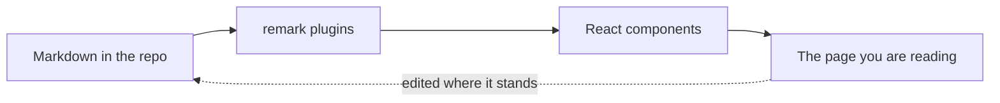
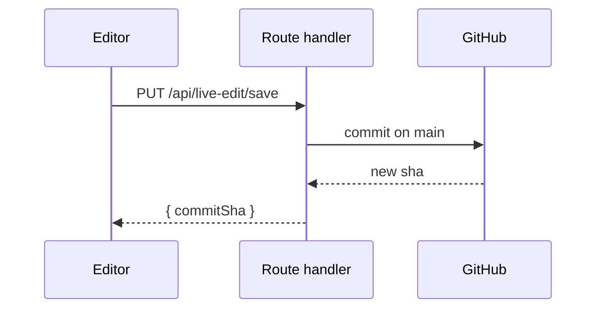

Every block from the block list in the blocks skill (`.agents/skills/blocks/SKILL.md`), once each, with the variants that have a way to break. Open this page after touching `packages/core/css/custom.css`, the default palette in `packages/core/css/brand.css`, a project's brand stylesheet or anything under `packages/core/components/`, and scroll. If a block looks wrong here, it looks wrong everywhere.

The same page, opened in the browser editor, is also the editor's test: each block here has to round-trip through a save without changing a byte.

## Plain markdown

Running text with **bold**, *italic*, `inline code`, a [relative link](../how-it-works/browser-editor.mdx), a [site-absolute link](/guides/mermaid-diagrams) and an <abbr title="A hover tooltip explaining a term in plain words">abbr</abbr> with a title. A second sentence, long enough to wrap onto another line at the default column width, so line height and the measure can be judged at the same time.

> A blockquote. The plugin styles this; nothing of ours touches it any more.

- An unordered list
- With a second item
  - And a nested one

1. An ordered list
2. With a second step
3. And a third, because the numbering only shows at three

---

### A third-level heading

#### And a fourth

Text under the smallest heading anybody should use.

## Tables

A markdown table is a markdown table. There is no component to import and no
wrapper to type: the framework's `table` puts the element in a scrolling box
and the prose typography draws the rest.

| Column | Meaning | Default |
| --- | --- | --- |
| `title` | The page name in the sidebar | required |
| `description` | The card subtitle and the search snippet | none |
| `pages` | The order inside a folder | alphabetical |

The dashes under the header row carry the alignment, and a colon is what moves
it. Left is the default, `:---:` centres, `---:` pushes right, which is the one
you want for a column of numbers:

| Left | Centred | Right |
| :--- | :---: | ---: |
| `docs/index.mdx` | yes | 1 |
| `docs/meta.json` | no | 24 |
| `docs/decision-records/0006-fumadocs.mdx` | yes | 1,208 |

Cells take inline markdown, so a table of pages can link to them:

| Page | Section | Why it exists |
| --- | --- | --- |
| [Browser editor](../how-it-works/browser-editor.mdx) | How it works | **The** thing people ask about first |
| [Mermaid diagrams](../how-it-works/mermaid-diagrams.mdx) | Guides | Fences that render as `<Mermaid />` |
| [Documentation](../index.mdx) | Documentation | The page every reader lands on |

A table wider than the article column scrolls sideways inside its own box rather
than pushing the page out, so grab this one and drag:

| Field | Type | Required | Default | Where it is read | What breaks without it |
| --- | --- | --- | --- | --- | --- |
| `title` | `string` | yes | none | `meta.json`, front matter | The sidebar row has no words in it |
| `description` | `string` | yes | none | Section cards, search results | The card is a title and a blank space |
| `icon` | Lucide name | no | none | Sidebar, page heading | Nothing; the row is text only |
| `pages` | `string[]` | no | alphabetical | Sidebar order | Order follows the file names |
| `root` | `boolean` | no | `false` | Section switcher | The folder joins its parent's tree |
| `pagesIndex` | `string` | no | none | Section switcher target | The switcher row opens whichever page is first |

The same table inside `:::wide` stands wider than the column, centred on it,
and inside `:::full` it runs to the edges of the page. On a screen with no room
to spare both read as an ordinary table:

:::wide

| Field | Type | Required | Default | Where it is read | What breaks without it |
| --- | --- | --- | --- | --- | --- |
| `title` | `string` | yes | none | `meta.json`, front matter | The sidebar row has no words in it |
| `description` | `string` | yes | none | Section cards, search results | The card is a title and a blank space |
| `icon` | Lucide name | no | none | Sidebar, page heading | Nothing; the row is text only |

:::

:::full

| Field | Type | Required | Default | Where it is read | What breaks without it |
| --- | --- | --- | --- | --- | --- |
| `pages` | `string[]` | no | alphabetical | Sidebar order | Order follows the file names |
| `root` | `boolean` | no | `false` | Section switcher | The folder joins its parent's tree |
| `pagesIndex` | `string` | no | none | Section switcher target | The switcher row opens whichever page is first |

:::

## Callouts

:::note

A note, with no label, so it prints its own name.

:::

:::tip[With a label]

A tip carrying a custom label and *emphasis* inside.

:::

:::info

An info callout.

:::

:::warning

A warning. `:::warn` and `:::caution` are the same block.

:::

:::danger

A danger callout, for the thing that loses data.

:::

:::source

The grey one with a bookmark, for where a pattern comes from. Fowler, *Refactoring*, 2nd edition, 2018.

:::

## Code fences

A fence with a title and line numbers:

```ts title="lib/source.ts" lineNumbers
import { loader } from "fumadocs-core/source";
import { docs } from "@/.source/server";

export const source = loader({
  baseUrl: "/",
  source: docs.toFumadocsSource(),
});
```

Annotations, one of each kind:

```ts
const before = "this line is highlighted"; // [!code highlight]
const removed = "this line is a deletion"; // [!code --]
const added = "this line is an addition"; // [!code ++]
const word = parseDocument(source); // [!code word:parseDocument]
```

Focus dims everything that is not marked:

```ts
function unrelated() {}

export function theOneThatMatters() {} // [!code focus]

function alsoUnrelated() {}
```

Two adjacent fences with `tab="…"` become one tabbed block:

```bash tab="bun"
bun add fumadocs-core fumadocs-ui
```

```bash tab="npm"
npm install fumadocs-core fumadocs-ui
```

A fence with no language at all:

```
plain text, no highlighting, still framed
```

## Images

A screenshot with alt text and a caption:


The same file with no alt and no caption, which marks it decorative:


The same picture inside `:::wide`, which fills the wider block and drops the
screenshot height cap:

:::wide


:::

An image with no path, which a paste writes for a picture it could not download:


An image whose path answers with no picture:


## Mermaid





## Video

Both this and the card below are insertable from the browser editor, and both write a JSX tag, so the slash menu withholds them on a `.md` page where a tag renders as literal text. See [the browser editor](../how-it-works/browser-editor.mdx).

<VideoEmbed url="https://www.youtube.com/watch?v=dQw4w9WgXcQ" />

## Link embed

Every prop set, the way a paste writes it:

<LinkEmbed
  url="https://fumadocs.dev/"
  title="Fumadocs"
  description="The React.js documentation framework."
  site="Fumadocs"
  image="https://www.fumadocs.dev/banner.png"
  favicon="https://www.fumadocs.dev/icon.png?icon.1j4qb02i3kfg4.png"
/>

A repository, its picture a wide social card:

<LinkEmbed
  url="https://github.com/vercel/next.js"
  title="GitHub - vercel/next.js: The React Framework"
  description="The React Framework. Contribute to vercel/next.js development by creating an account on GitHub."
  site="GitHub"
  image="https://repository-images.githubusercontent.com/70107786/4602445c-10a2-4903-a360-c96d70531f67"
  favicon="https://github.githubassets.com/favicons/favicon.png"
/>

Only the required prop, as a page behind a sign-in answers:

<LinkEmbed url="https://dev.azure.com/contoso/handbook/_wiki/wikis/handbook.wiki/1/Getting-started" />

## File attachment

Every prop set:

<FileAttachment
  href="/files/docs/block-tests-sample.txt"
  name="block-tests-sample.txt"
  size="158"
  uploadedAt="2026-09-09"
  note="A two-line text file that exists so this card has something real to download."
/>

Only the required prop:

<FileAttachment href="/files/docs/block-tests-sample.txt" />

## Figures

An inline SVG figure drawn against the `--jd-fig-*` palette, so it follows the colour mode. Click it: it opens on the fullscreen stage, in the same palette, with the labels still in the mono face:

<figure className="jd-fig">
  <div className="jd-fig-frame">
    <svg viewBox="0 0 920 240" role="img" aria-label="Three boxes in a row, labelled Presentation, Domain and Infrastructure, each in its own layer colour, joined by arrows left to right, with a small accent-coloured chip below them.">
      <defs>
        <marker id="bt-arrow" viewBox="0 0 10 10" refX="9" refY="5" markerWidth="7" markerHeight="7" orient="auto-start-reverse">
          <path d="M0,0 L10,5 L0,10 z" fill="var(--jd-fig-line)" />
        </marker>
      </defs>
      <text x="40" y="44" fontSize="10" letterSpacing="1.5" fill="var(--jd-fig-muted)">THE THREE LAYER COLOURS, AND THE ACCENT</text>
      <rect x="40" y="70" width="240" height="90" rx="10" fill="var(--jd-fig-p-bg)" stroke="var(--jd-fig-line-soft)" />
      <text x="160" y="110" fontSize="15" fontWeight="600" textAnchor="middle" fill="var(--jd-fig-p-ink)">Presentation</text>
      <text x="160" y="134" fontSize="11.5" textAnchor="middle" fill="var(--jd-fig-muted)">--jd-fig-p-*</text>
      <line x1="280" y1="115" x2="336" y2="115" stroke="var(--jd-fig-line)" strokeWidth="1.5" markerEnd="url(#bt-arrow)" />
      <rect x="340" y="70" width="240" height="90" rx="10" fill="var(--jd-fig-d-bg)" stroke="var(--jd-fig-line-soft)" />
      <text x="460" y="110" fontSize="15" fontWeight="600" textAnchor="middle" fill="var(--jd-fig-d-ink)">Domain</text>
      <text x="460" y="134" fontSize="11.5" textAnchor="middle" fill="var(--jd-fig-muted)">--jd-fig-d-*</text>
      <line x1="580" y1="115" x2="636" y2="115" stroke="var(--jd-fig-line)" strokeWidth="1.5" markerEnd="url(#bt-arrow)" />
      <rect x="640" y="70" width="240" height="90" rx="10" fill="var(--jd-fig-i-bg)" stroke="var(--jd-fig-line-soft)" />
      <text x="760" y="110" fontSize="15" fontWeight="600" textAnchor="middle" fill="var(--jd-fig-i-ink)">Infrastructure</text>
      <text x="760" y="134" fontSize="11.5" textAnchor="middle" fill="var(--jd-fig-muted)">--jd-fig-i-*</text>
      <rect x="40" y="184" width="232" height="32" rx="4" fill="var(--jd-fig-accent-soft)" stroke="var(--jd-fig-accent)" strokeWidth="1.5" />
      <text x="156" y="205" fontSize="11.5" textAnchor="middle" fill="var(--jd-fig-accent)">--jd-fig-accent</text>
      <text x="880" y="205" fontSize="11.5" textAnchor="end" fill="var(--jd-fig-ink)">Switch the colour mode: every fill and stroke should follow.</text>
    </svg>
  </div>
  <figcaption>A figure caption, hidden on the page and shown under the drawing when it is expanded.</figcaption>
</figure>

The escape hatch is an HTML figure, for the cases SVG is worse at: real text
wrapping, a long list, a comparison dressed as a figure. It has no drawing for
the stage to show, so it offers none of the stage's affordances. Hover it: no
zoom cursor, no border brightening, no Click to expand.

<figure className="jd-fig fig-bt-html">
  <style>{`
    .fig-bt-html .fig-row { display: flex; gap: 0.75rem; flex-wrap: wrap; }
    .fig-bt-html .fig-cell { flex: 1 1 12rem; padding: 0.9rem 1rem; border-radius: 8px; background: var(--jd-fig-surface); border: 1px solid var(--jd-fig-line-soft); }
    .fig-bt-html .fig-cell.is-staged { background: var(--jd-fig-d-bg); border-color: var(--jd-fig-d-ink); }
    .fig-bt-html .fig-name { font-family: var(--font-label); font-size: 0.75rem; letter-spacing: 0.08em; color: var(--jd-fig-muted); }
    .fig-bt-html .fig-body { margin-top: 0.3rem; font-size: 0.875rem; color: var(--jd-fig-ink); }
  `}</style>
  <div className="jd-fig-frame">
    <div className="fig-row">
      <div className="fig-cell is-staged">
        <div className="fig-name">SVG FIGURE</div>
        <div className="fig-body">Holds a drawing, so it opens on the stage.</div>
      </div>
      <div className="fig-cell">
        <div className="fig-name">HTML FIGURE</div>
        <div className="fig-body">Holds text, so it stays on the page.</div>
      </div>
    </div>
  </div>
  <figcaption>An HTML figure. The colours are the same `--jd-fig-*` tokens, so it follows the colour mode too.</figcaption>
</figure>

## Charts

A bar chart with two series, then a horizontal one with a unit, a stacked area
and a donut.

<Chart
  type="bar"
  x="month"
  data={[
    { month: "Apr", saves: 186, builds: 80 },
    { month: "May", saves: 305, builds: 200 },
    { month: "Jun", saves: 237, builds: 120 },
    { month: "Jul", saves: 73, builds: 190 },
    { month: "Aug", saves: 209, builds: 130 },
    { month: "Sep", saves: 214, builds: 140 }
  ]}
  series={{ saves: "Studio saves", builds: "Publication builds" }}
  caption="Studio saves and publication builds per month."
/>

<Chart
  type="bar"
  horizontal
  x="page"
  unit="ms"
  data={[
    { page: "Overview", ms: 210 },
    { page: "Manual", ms: 160 },
    { page: "ADRs", ms: 120 }
  ]}
  series={{ ms: "First paint" }}
/>

<Chart
  type="area"
  stacked
  x="month"
  data={[
    { month: "Apr", saves: 186, builds: 80 },
    { month: "May", saves: 305, builds: 200 },
    { month: "Jun", saves: 237, builds: 120 },
    { month: "Jul", saves: 73, builds: 190 }
  ]}
  series={{ saves: "Studio saves", builds: "Publication builds" }}
/>

<Chart
  type="pie"
  x="host"
  data={[
    { host: "Vercel", sites: 12 },
    { host: "Docker", sites: 7 },
    { host: "S3", sites: 3 }
  ]}
  series={{ sites: "Sites" }}
/>

## Layout components

Five families of layout components are registered, so a page uses them with no import. Each one gets its own heading here so a styling change can be checked against it directly.

Five of the six open as themselves in the browser editor: Tabs, Steps, Accordions, Files and Cards each edit in place, with the prose inside them ordinary prose, and each is on the slash menu too. The type table is the one that does not, and it says below why. It still round-trips: the editor draws it as a greyed-out inert block and writes it back byte for byte, which is why it belongs on this page. The menu lives in `apps/studio/src/plugins/live-edit/inplace/slash.tsx`, and [the browser editor](../how-it-works/browser-editor.mdx) explains why an entry cannot be added before a node is.

### Tabs

<Tabs items={['bun', 'npm', 'pnpm']}>
  <Tab value="bun">Content of the bun tab.</Tab>
  <Tab value="npm">Content of the npm tab.</Tab>
  <Tab value="pnpm">Content of the pnpm tab.</Tab>
</Tabs>

### Steps

<Steps>
  <Step>
    ### Write the page
    Create the `.mdx` file and give it front matter.
  </Step>
  <Step>
    ### List it
    Add its name to the folder's `meta.json`.
    ```json
    { "pages": ["block-tests", "..."] }
    ```
  </Step>
  <Step>
    ### Build
    Run `bun run check:links` before you commit.
  </Step>
</Steps>

### Files

<Files>
  <Folder name="docs" defaultOpen>
    <File name="index.mdx" />
    <File name="meta.json" />
    <Folder name="manual" defaultOpen>
      <File name="block-tests.mdx" />
      <File name="meta.json" />
    </Folder>
  </Folder>
</Files>

### Cards

<Cards>
  <Card title="Browser editor" description="How a save becomes a commit." href="/how-it-works/browser-editor" />
  <Card title="Mermaid diagrams" description="Ten diagram types, worked through." href="/guides/mermaid-diagrams" />
</Cards>

### Accordions

<Accordions defaultValue="Why is this one already open?">
  <Accordion title="Why is this one already open?">
    `defaultValue` on `<Accordions>` is the title of the panel that starts
    expanded. Leave it off and every panel starts closed.
  </Accordion>
  <Accordion title="Can a panel hold a code block?" id="panel-with-code">
    Yes. A panel is ordinary MDX, so anything else on this page goes inside one.
    This panel also carries an `id`, which is what puts the link button on its
    right and makes the panel open when somebody arrives on that anchor.

    ```json
    { "pages": ["block-tests", "..."] }
    ```
  </Accordion>
  <Accordion title="Can two panels be open at once?">
    Only with `type="multiple"` on `<Accordions>`. The default is `"single"`,
    where opening one closes the last.
  </Accordion>
</Accordions>

## Card grid

The section's own card grid, bound to this page, with a custom title. This page is never listed in it:

<DocCardList title="The rest of this section" />
