A fenced code block marked `mermaid` comes out of the build as a diagram. You type the boxes and the arrows as lines of text, the browser draws them, and what lives in the repository is the text.

That last part is the whole reason to bother. A diagram exported as a PNG from a drawing tool is wrong the day after the system changes, and nobody can fix it without the original file, which is on somebody's laptop. A Mermaid fence is prose as far as git is concerned. Renaming a service in a diagram is the same size of edit as renaming it in a sentence, and you can do it on the page itself, by clicking the node.

<figure className="jd-fig">
  <div className="jd-fig-frame">
    <svg viewBox="0 0 920 300" role="img" aria-label="Text in a mermaid fence becomes a framed drawing sized to the article column, and clicking that opens a fullscreen stage with a minimap.">
      <defs>
        <marker id="mm-arrow" viewBox="0 0 10 10" refX="9" refY="5" markerWidth="7" markerHeight="7" orient="auto-start-reverse">
          <path d="M0,0 L10,5 L0,10 z" fill="var(--jd-fig-line)" />
        </marker>
      </defs>

      <rect x="20" y="40" width="240" height="180" rx="6" fill="var(--jd-fig-p-bg)" stroke="var(--jd-fig-line-soft)" />
      <text x="38" y="34" fontSize="10" letterSpacing="1.5" fill="var(--jd-fig-muted)">WHAT YOU TYPE</text>
      <text x="40" y="68" fontSize="11.5" fill="var(--jd-fig-p-ink)">{"```mermaid"}</text>
      <text x="40" y="90" fontSize="11.5" fill="var(--jd-fig-p-ink)">flowchart LR</text>
      <text x="52" y="112" fontSize="11.5" fill="var(--jd-fig-p-ink)">A[Queue] --&gt; B[Worker]</text>
      <text x="52" y="134" fontSize="11.5" fill="var(--jd-fig-p-ink)">B --&gt; C[(Store)]</text>
      <text x="40" y="156" fontSize="11.5" fill="var(--jd-fig-p-ink)">{"```"}</text>
      <text x="40" y="196" fontSize="10.5" fill="var(--jd-fig-muted)">four lines, in the .mdx file</text>

      <line x1="268" y1="130" x2="316" y2="130" stroke="var(--jd-fig-line)" strokeWidth="1.5" markerEnd="url(#mm-arrow)" />
      <text x="292" y="118" textAnchor="middle" fontSize="10" fill="var(--jd-fig-muted)">build</text>

      <rect x="324" y="40" width="250" height="180" rx="6" fill="var(--jd-fig-surface)" stroke="var(--jd-fig-line-soft)" />
      <text x="342" y="34" fontSize="10" letterSpacing="1.5" fill="var(--jd-fig-muted)">ON THE PAGE</text>
      <line x1="342" y1="62" x2="500" y2="62" stroke="var(--jd-fig-line-soft)" strokeWidth="4" />
      <line x1="342" y1="74" x2="556" y2="74" stroke="var(--jd-fig-line-soft)" strokeWidth="4" />
      <rect x="342" y="90" width="214" height="76" rx="4" fill="var(--jd-fig-d-bg)" stroke="var(--jd-fig-d-ink)" />
      <rect x="358" y="114" width="44" height="26" rx="3" fill="var(--jd-fig-surface)" stroke="var(--jd-fig-d-ink)" />
      <line x1="402" y1="127" x2="424" y2="127" stroke="var(--jd-fig-d-ink)" strokeWidth="1.5" markerEnd="url(#mm-arrow)" />
      <rect x="428" y="114" width="44" height="26" rx="3" fill="var(--jd-fig-surface)" stroke="var(--jd-fig-d-ink)" />
      <line x1="472" y1="127" x2="494" y2="127" stroke="var(--jd-fig-d-ink)" strokeWidth="1.5" markerEnd="url(#mm-arrow)" />
      <rect x="498" y="114" width="44" height="26" rx="3" fill="var(--jd-fig-surface)" stroke="var(--jd-fig-d-ink)" />
      <line x1="342" y1="182" x2="520" y2="182" stroke="var(--jd-fig-line-soft)" strokeWidth="4" />
      <text x="342" y="206" fontSize="10.5" fill="var(--jd-fig-muted)">framed, and never taller than a screen</text>

      <line x1="582" y1="130" x2="630" y2="130" stroke="var(--jd-fig-line)" strokeWidth="1.5" markerEnd="url(#mm-arrow)" />
      <text x="606" y="118" textAnchor="middle" fontSize="10" fill="var(--jd-fig-muted)">click</text>

      <rect x="638" y="40" width="262" height="180" rx="6" fill="var(--jd-fig-i-bg)" stroke="var(--jd-fig-i-ink)" />
      <text x="656" y="34" fontSize="10" letterSpacing="1.5" fill="var(--jd-fig-i-ink)">FULLSCREEN STAGE</text>
      <rect x="668" y="72" width="70" height="34" rx="3" fill="var(--jd-fig-surface)" stroke="var(--jd-fig-i-ink)" />
      <line x1="738" y1="89" x2="768" y2="89" stroke="var(--jd-fig-i-ink)" strokeWidth="1.5" markerEnd="url(#mm-arrow)" />
      <rect x="772" y="72" width="70" height="34" rx="3" fill="var(--jd-fig-surface)" stroke="var(--jd-fig-i-ink)" />
      <rect x="668" y="126" width="70" height="34" rx="3" fill="var(--jd-fig-surface)" stroke="var(--jd-fig-i-ink)" />
      <line x1="703" y1="106" x2="703" y2="122" stroke="var(--jd-fig-i-ink)" strokeWidth="1.5" markerEnd="url(#mm-arrow)" />
      <rect x="836" y="166" width="52" height="38" rx="3" fill="var(--jd-fig-surface)" stroke="var(--jd-fig-i-ink)" strokeDasharray="3 2" />
      <rect x="842" y="172" width="22" height="16" rx="2" fill="var(--jd-fig-i-bg)" stroke="var(--jd-fig-i-ink)" />
      <text x="656" y="196" fontSize="10.5" fill="var(--jd-fig-i-ink)">pan, pinch, and a minimap</text>
    </svg>
  </div>
  <figcaption>The fence is the source of truth. The build hands its text to Mermaid, the page frames the result at the width of the article column, and a click opens it on a stage where a wide drawing is actually readable.</figcaption>
</figure>

Mermaid 11.17 does the parsing and the drawing. A fence marked `mermaid` is turned into a `<Mermaid />` tag at build time by `remarkMermaid`, which preserves its source range for editing, and `packages/core/components/blocks/Mermaid.tsx` is what that tag renders, so the syntax on this page is the syntax in the [Mermaid documentation](https://mermaid.js.org/intro/) with nothing added. What this site changed is only the presentation: the preview shrinks to the column like an image instead of overflowing, clicking it opens a stage where two-finger scroll pans and pinch zooms around the cursor, and a minimap in the corner shows where you are in a drawing bigger than the screen. Escape closes it.

The other choice worth knowing is that diagrams draw in Mermaid's light palette in both colour modes, and the stylesheet inverts the whole drawing in dark mode. Any colour you write into a diagram yourself, a lane fill or a note tint, then survives the switch. The component doing the drawing is framework rather than something you edit per site, so a fence renders the same way on every instance.

On handwritten pages, each diagram also has an **Edit diagram** button. Clicking
the drawing still opens the read-only fullscreen view. Edit opens the visual
tools for flowcharts, sequence diagrams and state diagrams; **Source** lets you
edit the Mermaid text for any diagram type. **Done** returns to the page.
Changes join the page's draft, undo history and browser recovery copy. Save
them with the page's **Save changes** action. Generated pages offer viewing only.

The rest of this page is examples. It opens with a representative publishing journey, then works through one small example per diagram type. Every fence is a copy-paste starting point.

## Sequence diagram: publishing a page

This journey is representative rather than a trace. It keeps the parts a reader needs to follow a page from the editor to the live site: the writer's action, the studio's request, the outside services and the answer that moves the screen forward.

The studio is the app on the writer's machine. GitHub holds the pages, a build host turns a commit into a site, and a link checker reads the result.

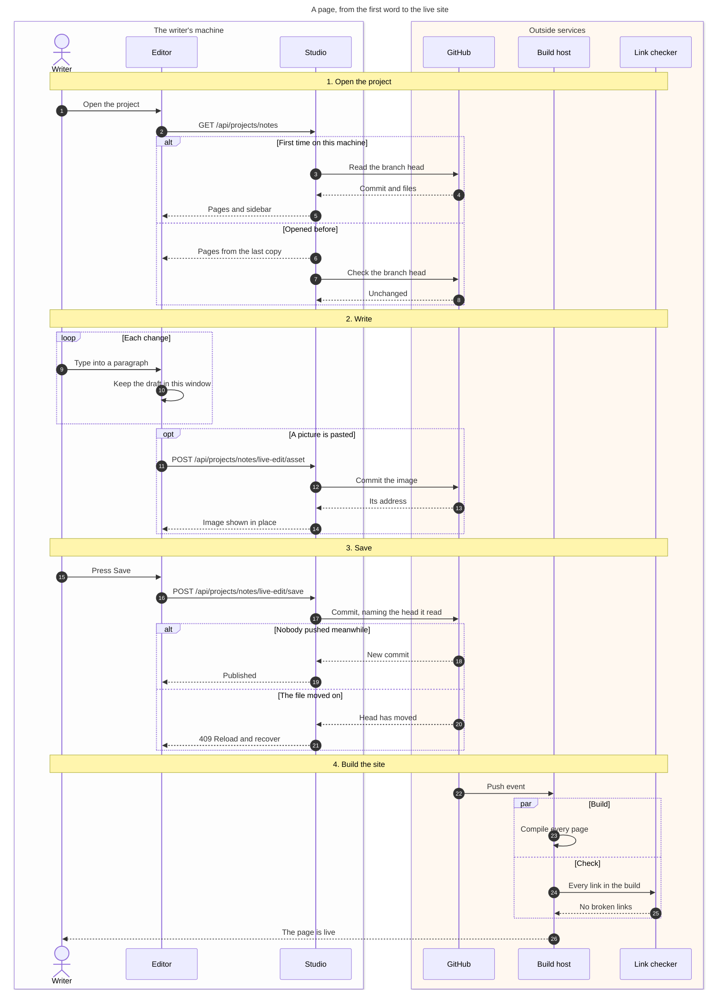

The diagram stays at one level of detail. Each chapter starts with something the writer does, crosses into a service, names the important call and returns to the editor. A trace of every request, cache and retry would hide that rhythm.

The control structures describe visible variations in the journey:

- `alt` separates a first open from a project opened before, then a clean save from one that has to reload.
- `loop` repeats for every change typed.
- `opt` keeps the image upload out of a page with no pictures.
- `par` says the build and the link check run together.

The boxes mark ownership boundaries, while solid arrows carry requests and dashed arrows carry replies. Activation bars, payloads and repeated checks are omitted because they add detail without changing the story. That is a useful test for a flow diagram: if removing a line does not change what the reader thinks happens next, remove it.

## User journey: a shopping flow

`journey` records the steps a person takes and how each step feels. The score after each step runs from one to five, so a lower score points at the part worth investigating before somebody guesses at a redesign.

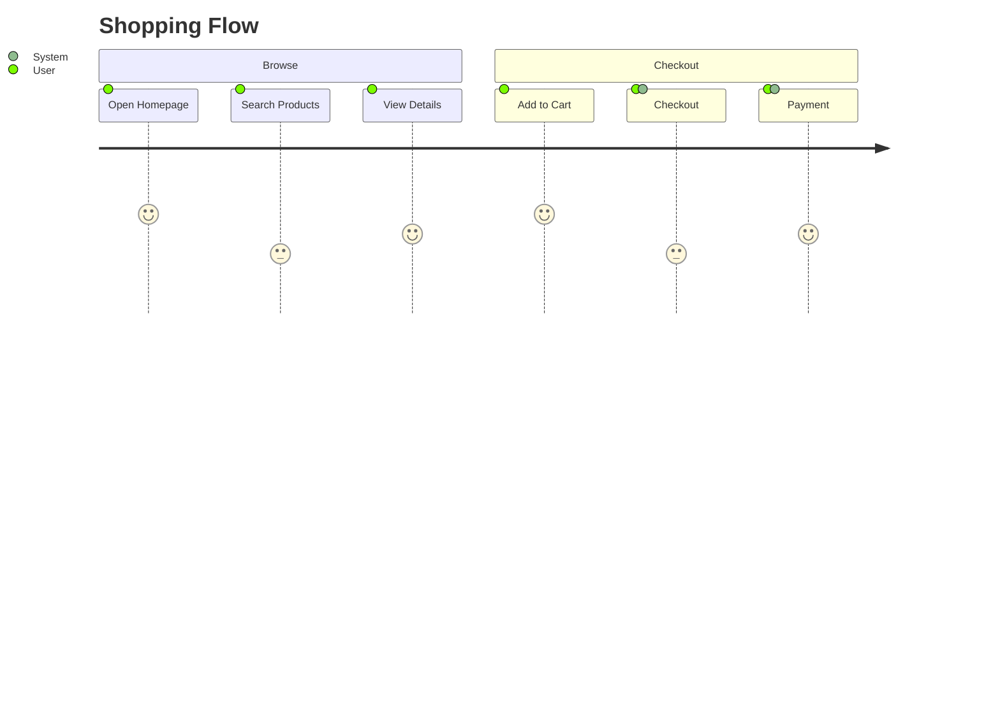

The people after each score show who takes part in that step. `Checkout` and `Payment` name both the shopper and the system because the screen cannot move on until each has done its part.

## Sequence diagram: an API request

`sequenceDiagram` is for time. Each participant gets a vertical lane, and every message is a line down the page, so the reader gets the order of events for free without you numbering anything.

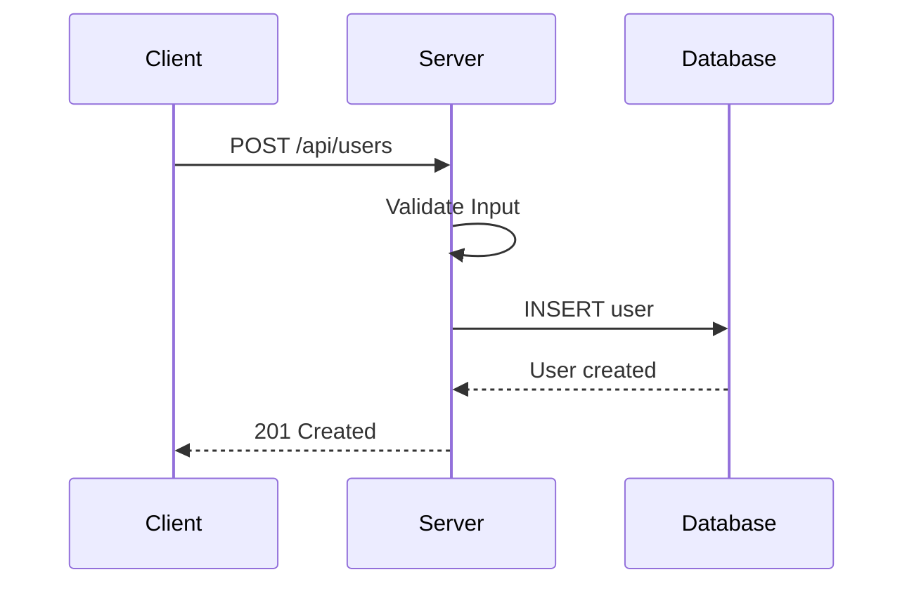

Two arrow shapes carry most of the meaning. `->>` is a call with a solid head, `-->>` is the reply, drawn dashed. Naming a participant twice in one line (`S->>S`) draws a self-call, which is how you show work that happens inside one box without inventing a fake service for it.

`participant C as Client` sets the short name you type against the label the reader sees. Skip the alias and you end up typing `Database` fifteen times, and the diff on a rename touches every line.

Reach for this whenever the order of events is the thing people get wrong. An ADR that puts a cache in front of the database, a page about a webhook that has to survive being delivered twice, a postmortem where the retry landed before the first write committed. Prose makes the reader hold five steps in their head and hope they assembled them in the right order. The diagram just shows it.

## Flowchart: validation with a retry

`flowchart` is for decisions. `TD` draws top-down, which suits a process with a failure path, because the retry arrow has somewhere to go.

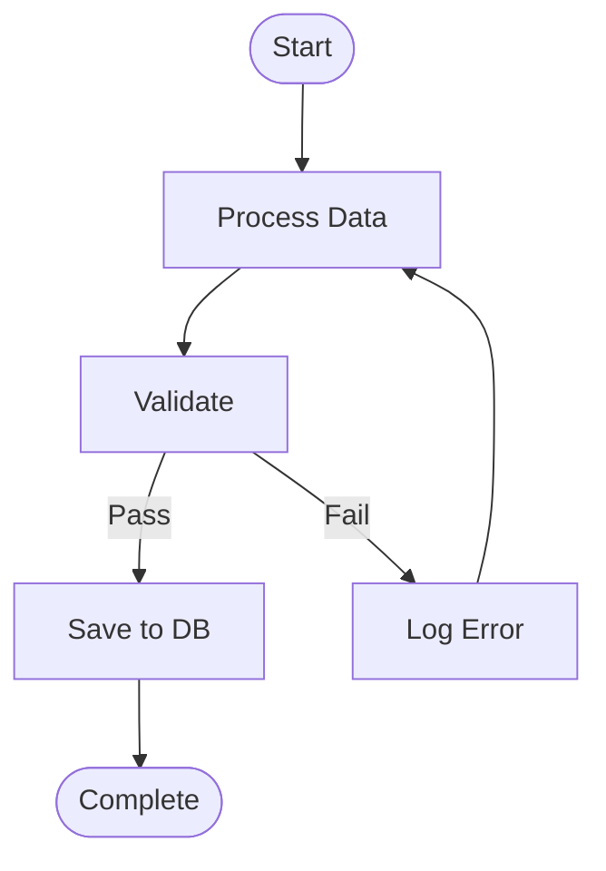

The brackets around a label pick the shape. `[Process Data]` is a rectangle for a step, `([Start])` is a stadium for an entry or exit point, and `{Validate}` would give you the traditional diamond if you want the decision to look like one. Text between pipes, `-->|Pass|`, labels the edge.

Node ids are what you connect, labels are what people read. Write the label once at the node's first mention and refer to the bare id after that, the way `E --> B` does here.

This is the shape for anything somebody has to operate. An on-call runbook where step four sends you back to step two, the rules a form applies before it will submit, the retry policy of an import job that re-queues a row it could not parse. If you catch yourself writing "if this fails, go back and", you want a flowchart.

## Flowchart: a CI/CD pipeline

Same `flowchart`, one token different. `LR` lays the graph out horizontally, and a pipeline reads better that way because the direction matches the way people already talk about it: code goes in one end, production comes out the other.

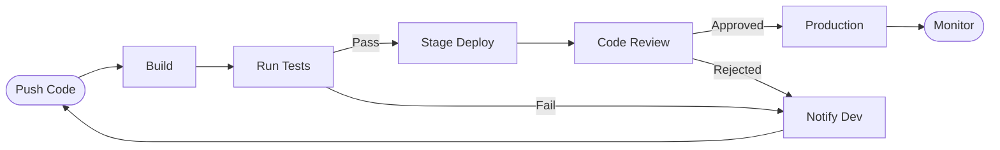

Two edges arrive at `E` from different failure points, which is the case for `LR` over `TD` here: the happy path stays a straight line across the page and the rejections fold back underneath it, instead of the whole thing turning into a column taller than the viewport.

A wide diagram like this is where the fullscreen stage earns its place. Inline it is scaled to the column, so click it if you want to read the edge labels.

Anything with stages and a gate between them fits here: the pipeline above, a release checklist, the path a support ticket takes from triage to closed. It pays for itself the moment somebody asks why their merged change is not live yet and you can point at the box it is sitting in.

## Sequence diagram: an OAuth exchange

Same `sequenceDiagram`, four participants and nine messages. Nobody reconstructs an OAuth exchange correctly from prose, so this is the diagram that stops the question coming up at every onboarding.

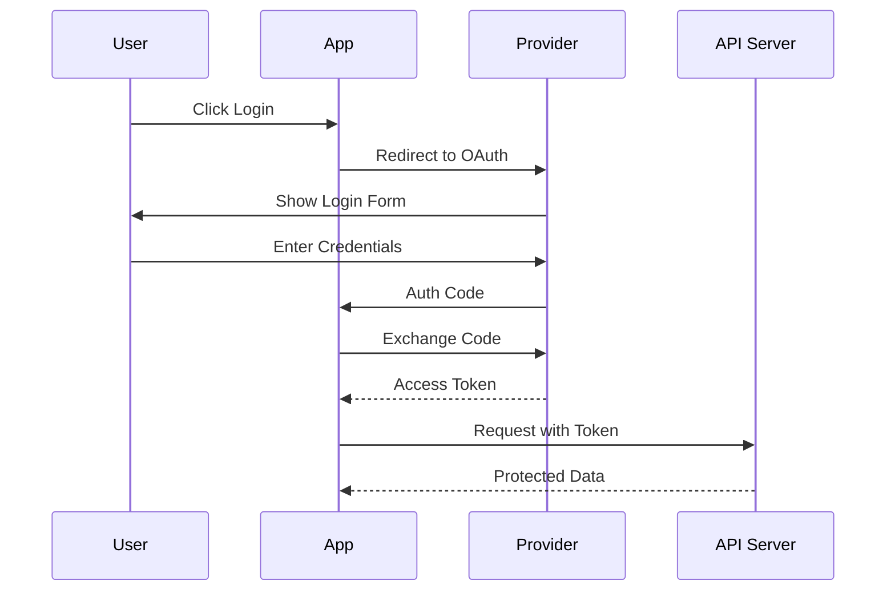

Look at where the dashed arrows are. The code comes back as a solid line because the provider is redirecting the browser, an action of its own, while the token and the protected data are dashed because they are answers to a call the app just made. Getting that distinction right is most of what makes a sequence diagram worth reading twice.

Third-party handshakes are where sequence diagrams earn their keep, because you did not design the exchange and cannot simplify it. An SSO setup page, a payment provider's 3-D Secure detour, a webhook signature check. A security reviewer wants this one too, since "who is holding the secret at this hop" becomes a question you answer by pointing at a lane.

## Class diagram: a data model

`classDiagram` draws types and what they hold. It is the right pick for a data model in code, an ORM's entities or a set of TypeScript interfaces, where the fields and the methods matter as much as the links.

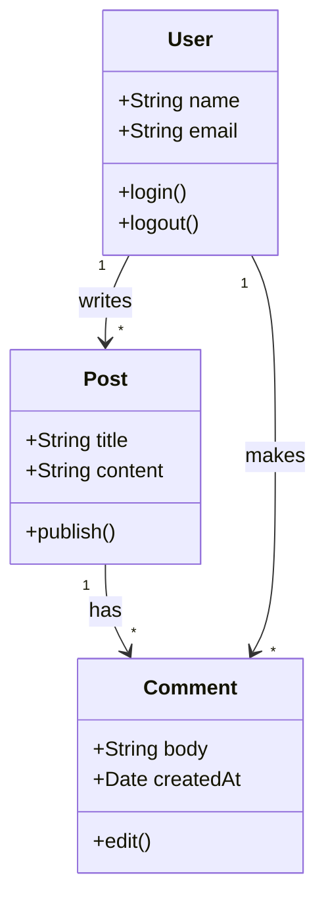

The `+` marks a member as public, `-` as private, and `#` as protected. Parentheses after a name make it a method rather than a field, which is the only thing separating `login()` from `email` as far as the renderer is concerned.

The quoted strings on a relationship are the cardinality, so `"1" --> "*"` reads as one user to many posts. Put the verb after the colon and read the line out loud to check it: user writes post.

Use it for a model people write code against rather than SQL against: the entities an ORM exposes before a migration changes them, the exported types of a shared package, a new aggregate an ADR is introducing. If the reader's next move is opening a migration file or a query console, the ER diagram below is the better pick.

## Mind map: a product overview

`mindmap` groups related ideas around one subject. It is useful early in a page, when the reader needs the shape of a product or system before the details start.

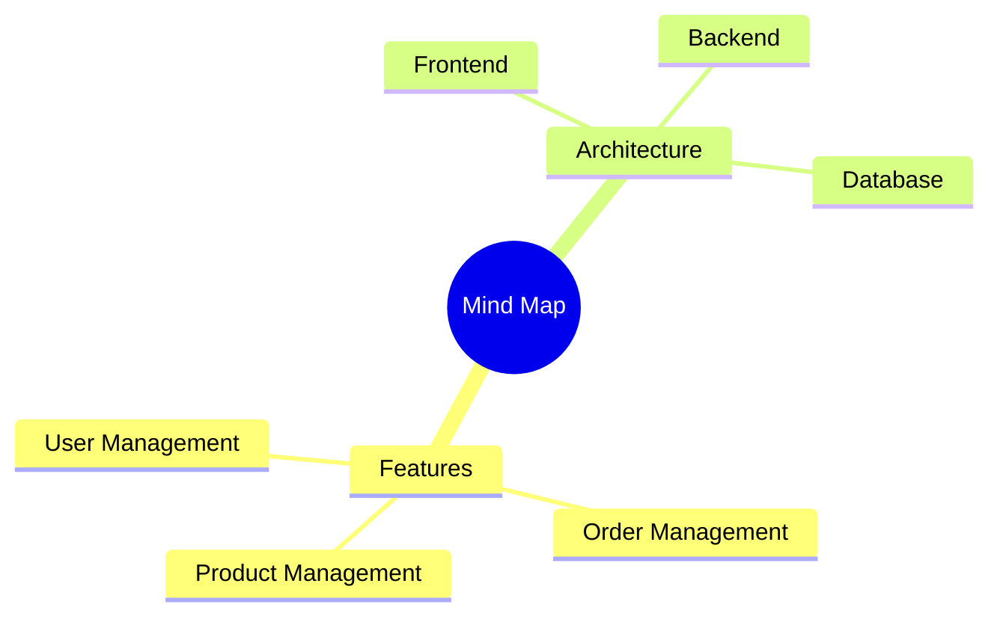

Indentation creates the branches. Start with one clear root, then keep each level in the same kind of language. This example separates what the product does from the pieces that run it.

## State diagram: an order lifecycle

`stateDiagram-v2` answers a different question from a flowchart. A flowchart is the path through a process; a state diagram is the list of states something can be sitting in right now, and which moves out of each one are legal.

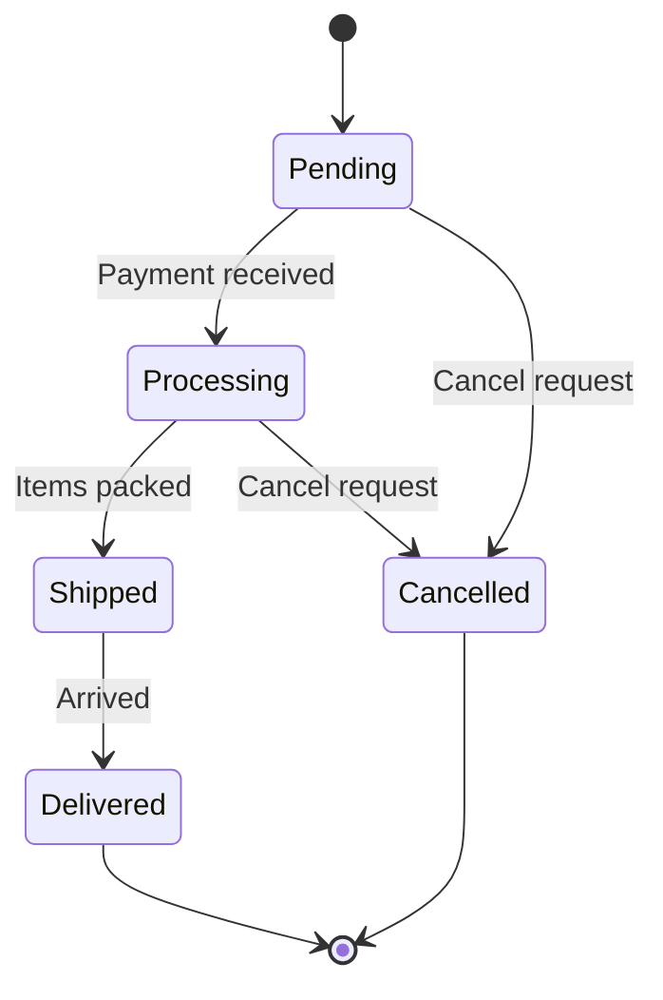

`[*]` is both the start and the end, depending on which side of the arrow it sits. The label after the colon is the event that causes the move, not a description of the next state, and keeping to that is what makes the diagram checkable against the code.

The useful thing here is the absence. There is no arrow out of `Shipped` to `Cancelled`, which says in one line of drawing what a paragraph of policy would take three tries to say clearly.

Anything with a `status` column deserves one of these. Orders, subscriptions, invoices, a moderation queue, a CI job, a feature flag part-way through a rollout. Draw it in the spec, where a reviewer can catch the transition nobody thought about, and again after a bug whose fix turns out to be that an illegal move was reachable.

## ER diagram: a database schema

`erDiagram` is for a database schema. Crow's foot notation on the ends of each line tells you how many rows on each side, which is the part a list of `CREATE TABLE` statements makes you work out yourself.

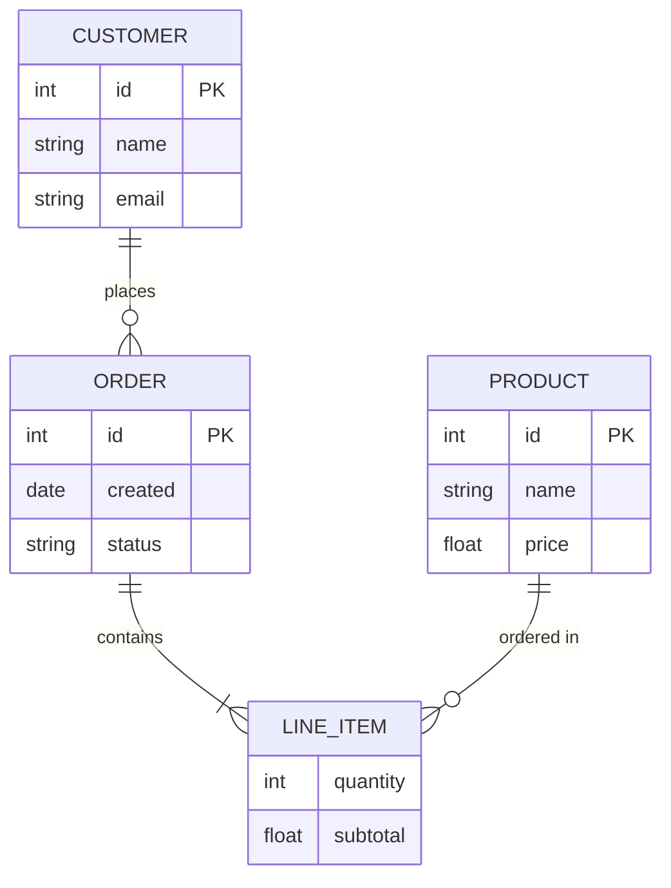

Read the connector as two halves. `||` is exactly one, `o{` is zero or more, `|{` is one or more. So `CUSTOMER ||--o{ ORDER` is one customer with any number of orders including none, and `ORDER ||--|{ LINE_ITEM` is an order that must have at least one line, which is a real constraint stated in two characters.

Inside a block the columns are `type name` plus an optional key marker, `PK` for a primary key and `FK` for a foreign one. A relationship label with a space in it needs quotes, as `"ordered in"` shows.

The moment to draw one is when somebody has to query a database they did not build, which covers onboarding, a handover, and every analyst who needs to know which table holds the customer email. The other good moment is next to the migration that adds a table, so the diagram and the DDL land in the same commit and go stale together rather than separately.

## Gantt chart: a project timeline

`gantt` is a schedule. It is worth reaching for when the dependencies are the point, because `after` computes the dates for you and a slipped task drags everything behind it.

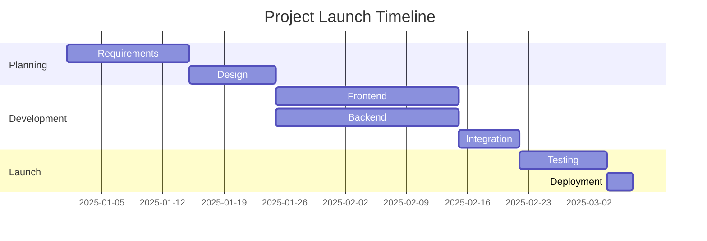

A `timeline` shows dated milestones without suggesting duration or dependency. Put it beside a Gantt chart when the reader needs the important dates first and the schedule second.

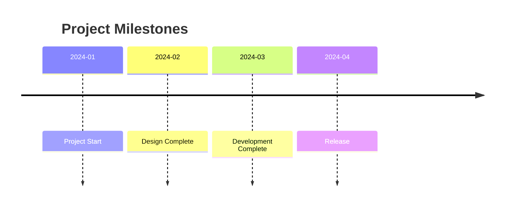

Each task line is a label, then an id, then a start, then a duration. Only the first task carries a real date. Everything after it says `after <id>`, so pushing `2025-01-01` out by a week moves the whole plan and you do not touch another line.

`Frontend` and `Backend` both start `after a2` and land on the same rows of the chart, which is how you say two streams run in parallel. Note also that nothing here says who is doing the work, which is the honest limit of the format.

Keep this for plans with a date somebody else is holding you to: a migration with a cutover weekend, a deprecation with a shutdown date, the phases of an RFC. Sprint-level work does not belong here, because the tracker already has it and a chart in markdown will be wrong by Thursday.

## Pie chart: a technology split

`pie` for a handful of parts of a whole. Six slices is about the ceiling before the labels start fighting.

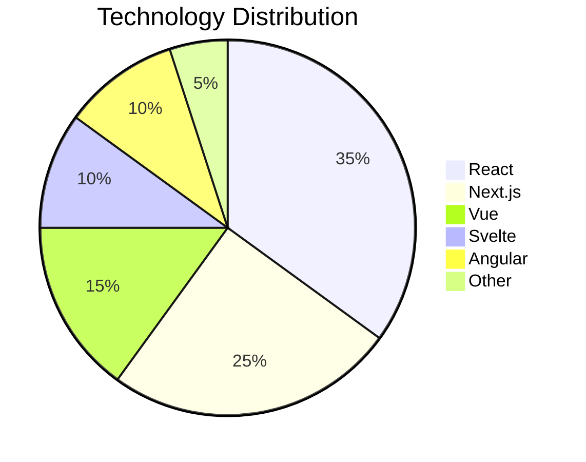

Mermaid works out the percentages, so the numbers you give can be raw counts and do not have to add up to 100.

Be honest about when this beats a sentence, though. Two or three values are clearer written out ("about a third of our projects are on React"), and more than eight want a table where the reader can compare exact figures.

When you do use one, date it. A snapshot of traffic by app version, or the split of projects across frameworks, is worth having in a page that argues for a migration. The same chart is worthless a year on if nobody wrote down when it was measured and where the numbers came from.

## Git graph: a branching model

`gitGraph` draws commit history. It is for explaining a branching convention to somebody new, where the words "cut a release branch off develop" do not land until they see the line leave and come back.

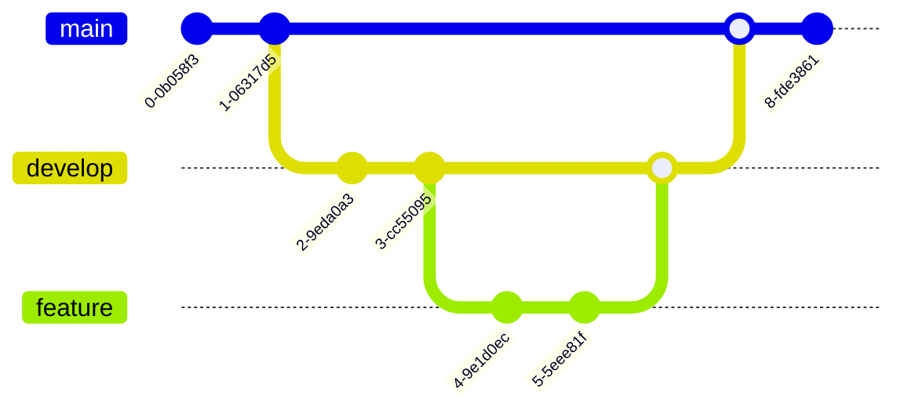

The syntax is the git commands you would type, in order, which means you can read it as a script and check it against what you really do. `branch` creates and `checkout` switches, and Mermaid needs both, unlike `git checkout -b`.

Give a commit a tag when it matters (`commit tag: "v1.2.0"`), and keep the graph to the pattern you are teaching. A faithful copy of a month of real history is unreadable and would be out of date by the time you published it.

The pages that want one are the branching convention, the release process, and the hotfix path, where the answer involves cutting a branch off a tag and merging it back into two places. It is also the quickest way to settle a merge-versus-rebase argument, because you can draw both policies and put them next to each other.

## When to draw a figure instead

Mermaid is for the diagrams where being correct matters more than being pretty: a schema, a state machine, a protocol exchange. It lays out the drawing itself, so you get consistency and no control, and it will occasionally route an arrow somewhere you would not have.

For anything explaining a concept rather than recording a structure, the answer here is an inline SVG figure drawn by the figure skill, like the one at the top of this page. Those are hand-placed, they use this site's own palette, and they can carry annotation and emphasis that Mermaid has no syntax for. The blocks skill (`.agents/skills/blocks/SKILL.md`) has the split written down.

:::tip
Split a long flow at its natural chapters into several fences with prose between them, rather than one tall drawing. A diagram the reader has to open fullscreen to follow at all has usually stopped being an aid to the paragraph next to it.
:::
